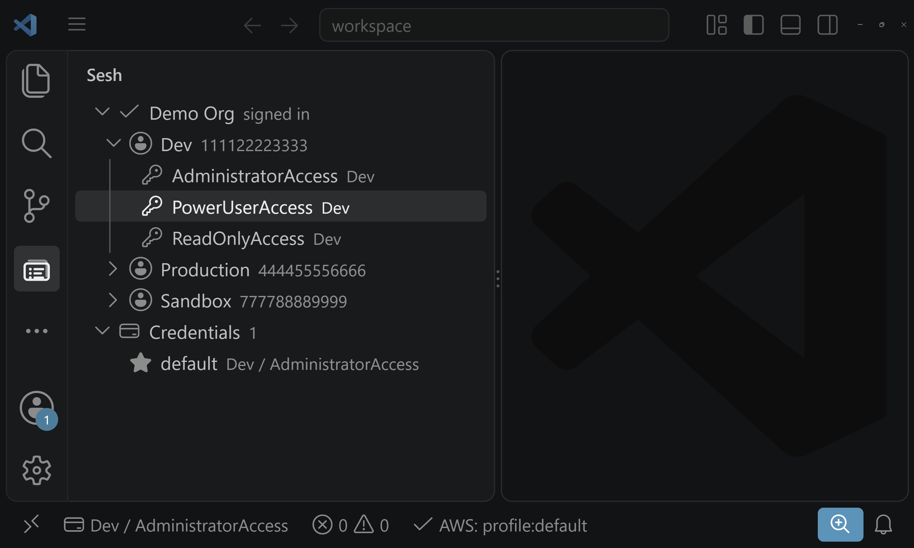

# Sesh for VS Code and compatible editors

Switch AWS SSO accounts, roles, and credentials from VS Code and the editors
built on the same extension API and Open VSX ecosystem, including Cursor, Kiro,
Windsurf, and VSCodium. It uses [awsesh](https://github.com/elva-labs/awsesh) and
its `@awsesh/core` SDK.

The extension is a thin UI over the SDK. It shares the same sessions,
credentials, and profiles as the awsesh CLI, TUI, and desktop app, so switching
here is visible everywhere else.



## What it does

- Status bar with the current account, role, and expiry, colored when the
  credential is close to expiring. Click it to switch.
- Command palette actions to switch credentials, set or clear them, sign in and
  out, open the AWS Console, copy the account ID or profile name, open the config
  and data directories, and refresh.
- Applies the active profile to integrated terminals, so runs and CLI commands
  use it.

## Activity bar

The **Sesh** view in the activity bar shows the Sesh mark and lists your
sessions, accounts, and roles. Expand a session to see its accounts, click an
account to load its roles, and click a role to set credentials. Right-click a
role or credential to open the AWS Console for that account and role. A
**Credentials** group lists the active profiles; clicking one copies its profile
name. The view and status bar refresh every minute and when the window regains
focus, so ended sessions and expired credentials drop out on their own.

## Commands

| Command | Description |
|---|---|
| `Sesh: Switch credentials` | Pick a session, account, and role, then assume it |
| `Sesh: Set credentials` | Same as switch |
| `Sesh: Clear credentials` | Remove a tracked profile |
| `Sesh: Sign in` / `Sesh: Sign out` | Manage the SSO session |
| `Sesh: Open AWS Console` | Open the console for the active credential, or right-click a role/credential in the tree |
| `Sesh: Copy account ID` / `Copy profile name` | Copy to the clipboard |
| `Sesh: Open config directory` / `Open data directory` | Open the shared directories |
| `Sesh: Open settings` | Open the Sesh settings |
| `Sesh: Open TUI` | Launch the awsesh TUI in an integrated terminal |
| `Sesh: Install awsesh CLI` | Guided install of the CLI (Homebrew on macOS/Linux, or the releases page) |
| `Sesh: Bind workspace to current credential` | Save the active credential as this workspace's binding |
| `Sesh: Clear workspace binding` | Remove this workspace's binding |
| `Sesh: Apply workspace profile` | Apply the workspace binding now |
| `Sesh: Refresh` | Reload sessions and credentials |

## awsesh CLI

Switching credentials and the tree work without the CLI. Install it when you want
the terminal interface: **Sesh: Install awsesh CLI** offers Homebrew on
macOS/Linux when it's available, and otherwise links to the releases page. It
never installs silently, and you can point `awsesh.binary` at an existing binary
instead.

## Settings

- `awsesh.applyToTerminal` (default `true`): apply the active profile to
  integrated terminals.
- `awsesh.statusBar` (default `true`): show the status bar item.
- `awsesh.statusBar.template` (default `"$(credit-card) {account} / {role}"`):
  status bar text. Placeholders: `{account}`, `{accountId}`, `{role}`,
  `{profile}`, `{session}`, `{region}`. Use `{account}` or `{role}` to save space.
- `awsesh.credentialsExpiryWarningMinutes` (default `15`): warn when the active
  credential expires within this many minutes.
- `awsesh.binary` (default `awsesh`): command or path used to launch the TUI.
- `awsesh.workspace.session|accountId|role`: the workspace binding.
- `awsesh.workspace.applyOnOpen` (default `false`): apply the binding silently
  in trusted workspaces instead of prompting once.
- `awsesh.autoRefresh` (default `false`): refresh the active credential before it
  expires.
- `awsesh.autoRefreshMinutes` (default `5`): how early to refresh.
- `awsesh.configDir`, `awsesh.dataDir`, `awsesh.awsDir`: override the shared
  directories (leave empty for the XDG and `~/.aws` defaults). Handy for testing
  against mock data.

## Trying it with mock data

The extension reads the same files as the CLI, so you can point it at generated
mock data and see the real UI without touching your own sessions or AWS:

```sh
bun run mock:data
```

Then set these in your workspace settings and reload the window:

```json
{
  "awsesh.configDir": "<repo>/.mock/home/.config/awsesh",
  "awsesh.dataDir": "<repo>/.mock/home/.local/share/awsesh"
}
```

Open the Sesh view to see the demo org, accounts, roles, and credential.

## Workspace binding

Bind a workspace to a session, account, and role so it opens on the right
profile. Run **Sesh: Bind workspace to current credential** to save it into
`.vscode/settings.json`:

```json
{
  "awsesh.workspace.session": "my-org",
  "awsesh.workspace.accountId": "123456789012",
  "awsesh.workspace.role": "AdministratorAccess"
}
```

On open, in a trusted workspace, Sesh prompts once before applying (it writes to
`~/.aws/credentials`). Set `awsesh.workspace.applyOnOpen` to `true` to skip the
prompt, or run **Sesh: Apply workspace profile** manually.

## Auto-refresh

Role credentials expire in about an hour. With `awsesh.autoRefresh` enabled,
Sesh re-assumes the active role shortly before expiry so a long session keeps
working. If the SSO token has expired, it warns and offers to sign in instead of
opening the browser on its own.

## Security and trust

- AWS tokens and credentials are never stored in VS Code settings or secret
  storage. They stay in the awsesh XDG data directory and `~/.aws`, shared with
  the other clients.
- In an untrusted workspace the extension is read-only: it shows the current
  credential but will not write credentials or change terminal environment
  variables.

## Troubleshooting

### `Token has expired and refresh failed` in the integrated terminal

Sesh writes static credentials to `~/.aws/credentials`. If `~/.aws/config` also
defines the same profile as an SSO profile (`sso_session`, `sso_account_id`,
`sso_role_name`), the AWS CLI prefers the SSO provider and ignores Sesh's
credentials.

Use a distinct profile name for Sesh, or remove the `sso_*` lines from that
`[profile ...]` block in `~/.aws/config`. The SSO session itself can stay under
`[sso-session ...]` if you still want `aws sso login --sso-session`.

## Development

Requires Node 20 or newer and Bun 1.4.2 (for `bun install` and the scripts).

```sh
bun install
bun run typecheck
bun run build
```

Press F5 in VS Code to launch an Extension Development Host.

## Testing

Unit tests run in Node/Bun with a mocked `vscode`:

```sh
bun test
```

They cover directory resolution, terminal environment mapping, status bar
rendering, workspace binding read/write, and the refresh scheduling math.

Integration tests run the extension in a real VS Code host:

```sh
bun run test:integration
```

They launch VS Code with an isolated `HOME`/XDG and a seeded session, activate the
extension, and check that commands register and the tree builds from the fixture.
On Linux CI, run them under `xvfb-run`.

It depends on the published `@awsesh/core`. To develop against a local checkout
instead, install the SDK from `packages/core` and add it with `bun link`, or set
the dependency to a `file:` path.

## Packaging

```sh
bun run package
```

Produces `awsesh-vscode-<version>.vsix`.

## Release

Publishing runs on a `v*` tag (and manual dispatch). Set `version` in
`package.json`, commit, then tag and push:

```sh
git commit -am "chore: release v0.1.0"
git tag v0.1.0
git push origin main --tags
```

The workflow builds and tests, then publishes to the Visual Studio Marketplace
and Open VSX with `--skip-duplicate`, so re-runs are safe. It needs the
`VSCE_PAT` and `OVSX_PAT` repository secrets, and the `gunnargrosch` publisher
on the Marketplace plus the matching Open VSX namespace.

## Credits

Sesh is an independent client for [awsesh](https://github.com/elva-labs/awsesh),
built on the MIT-licensed [`@awsesh/core`](https://www.npmjs.com/package/@awsesh/core)
SDK by [Elva Labs](https://github.com/elva-labs). The name, the Sesh mark, and the
session and credential model come from that project.

This extension is not affiliated with or endorsed by Elva Labs.

Bundled third-party code and its licenses are listed in
[THIRD-PARTY-NOTICES.md](THIRD-PARTY-NOTICES.md).

## License

MIT. See [LICENSE](LICENSE).
